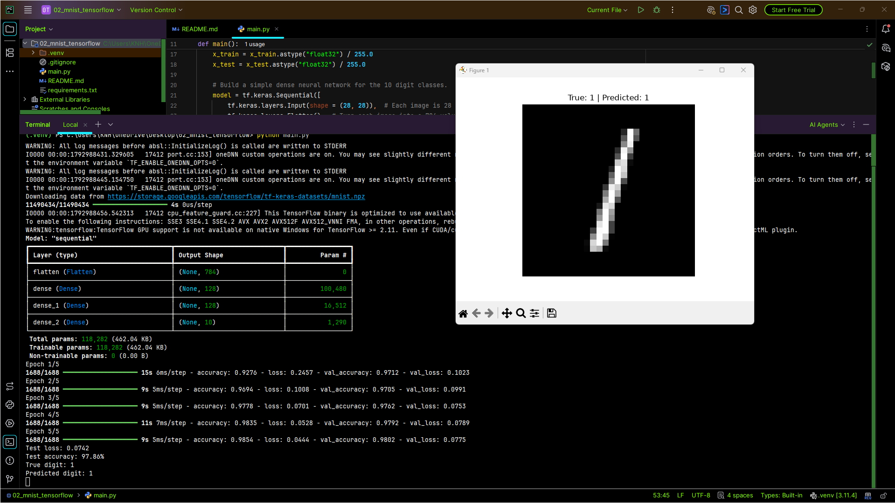
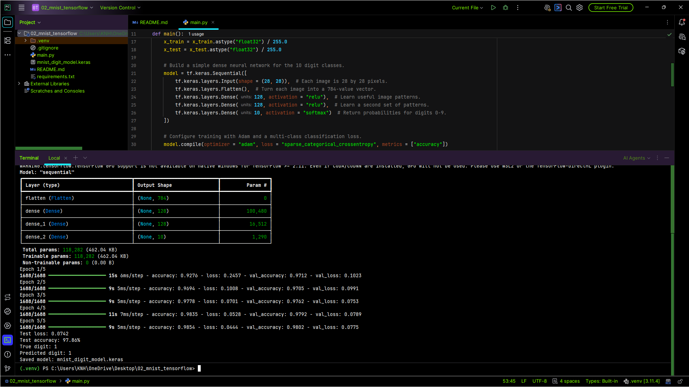

# Handwritten Digit Classification with TensorFlow / Keras

This project trains a small fully connected neural network to classify handwritten grayscale digit images from **0 through 9** using the MNIST dataset. It covers a basic deep-learning workflow: loading image data, normalizing pixels, defining a neural network, training with validation data, evaluating on a held-out test set, predicting an example, and saving the model.

## Project Goals

- Understand the structure of an image-classification dataset.
- Normalize pixel values before training.
- Build a Keras `Sequential` model using dense layers.
- Train a multi-class classifier with `sparse_categorical_crossentropy`.
- Interpret test loss and test accuracy.
- Compare the true digit with the model's prediction for one test image.
- Save the trained Keras model for reuse.

## Technology Stack

- **TensorFlow / Keras** — data loading, model definition, training, evaluation, and model saving
- **NumPy** — selecting the predicted class with `argmax`
- **Matplotlib** — displaying the example digit

## Dataset: MNIST

The script uses the built-in `tf.keras.datasets.mnist` dataset. MNIST contains 70,000 grayscale handwritten digit images split into 60,000 training examples and 10,000 test examples. Each image is 28 × 28 pixels and its label is an integer from 0 to 9.

TensorFlow downloads the dataset on the first run if it is not already cached. An internet connection may be required for that initial download. No custom CSV is required.

## Model Architecture

| Layer | Purpose |
|---|---|
| Input `(28, 28)` | Accepts a grayscale image. |
| `Flatten` | Converts the 28 × 28 image into a vector of 784 pixel values. |
| `Dense(128, ReLU)` | Learns an initial set of nonlinear features. |
| `Dense(128, ReLU)` | Learns another set of feature combinations. |
| `Dense(10, Softmax)` | Outputs class probabilities for digits 0–9. |

The model is a **fully connected network**, not a convolutional neural network. Flattening removes the image's explicit two-dimensional structure before the dense layers process it.

## Training Configuration

- **Optimizer:** Adam
- **Loss:** Sparse categorical cross-entropy
- **Metric:** Accuracy
- **Epochs:** 5
- **Batch size:** 32
- **Validation split:** 10% of the training data
- **Final evaluation:** Separate MNIST test set

The test set is used for final evaluation, not for gradient updates during training.

## Workflow

1. Load the MNIST training and test sets.
2. Convert pixel values from the `0–255` range to floating-point values in the `0–1` range.
3. Build the dense neural network.
4. Print the model summary.
5. Train for five epochs while monitoring validation metrics.
6. Evaluate the trained model on the held-out test set.
7. Predict one test image and print its true and predicted digits.
8. Display that image with its labels.
9. Save the trained model as `mnist_digit_model.keras`.

## Results and Generated Files

The script prints:

- Model architecture and parameter counts
- Training progress for each epoch
- Test loss
- Test accuracy
- True label and predicted label for one selected test image
- A confirmation message when the model is saved

It generates `mnist_digit_model.keras`. The displayed sample image is created by Matplotlib. Actual metrics can vary slightly with framework version, initialization, and hardware; this README intentionally does not promise a fixed score.

## Installation and Execution

```powershell
python -m venv .venv
.\.venv\Scripts\Activate.ps1
python -m pip install -r requirements.txt
python main.py
```

The first execution may take longer because the dataset must be downloaded and the model must be trained. Close the Matplotlib figure window if the script is waiting before continuing to the save step.

## Project Files

| File | Purpose |
|---|---|
| `main.py` | Loads MNIST, trains and evaluates the network, displays an example, and saves the model. |
| `requirements.txt` | Lists TensorFlow, Matplotlib, and NumPy dependencies. |
| `screenshot/output.png` | Screenshot of actual training/evaluation output or prediction window.|
| `mnist_digit_model.keras` | Generated model file after a successful run. |

## Output Screenshot




*The screenshot is expected at `screenshot/output.png` relative to this README.*

## Limitations

- A dense model does not explicitly learn local spatial patterns like a CNN.
- The script predicts one selected test image for demonstration rather than providing an interactive image-upload interface.
- Training accuracy and test accuracy describe this dataset and setup; they do not guarantee performance on images captured outside MNIST.
- The project does not include experiment tracking or deployment infrastructure.

## Possible Next Steps

- Plot training and validation accuracy across epochs.
- Display several correct and incorrect predictions.
- Compare the dense model with a CNN on MNIST.
- Add a confusion matrix and per-class evaluation.

**Project level:** Junior · TensorFlow / Keras · Neural Network Fundamentals · Image Classification

# Moe Htet Ar Kar (Phoe Cho)